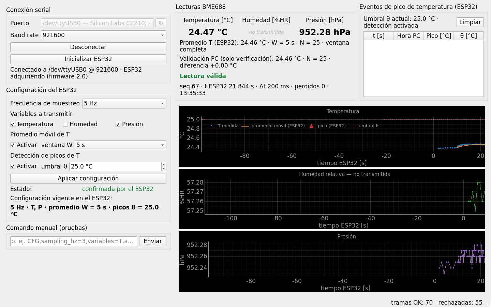
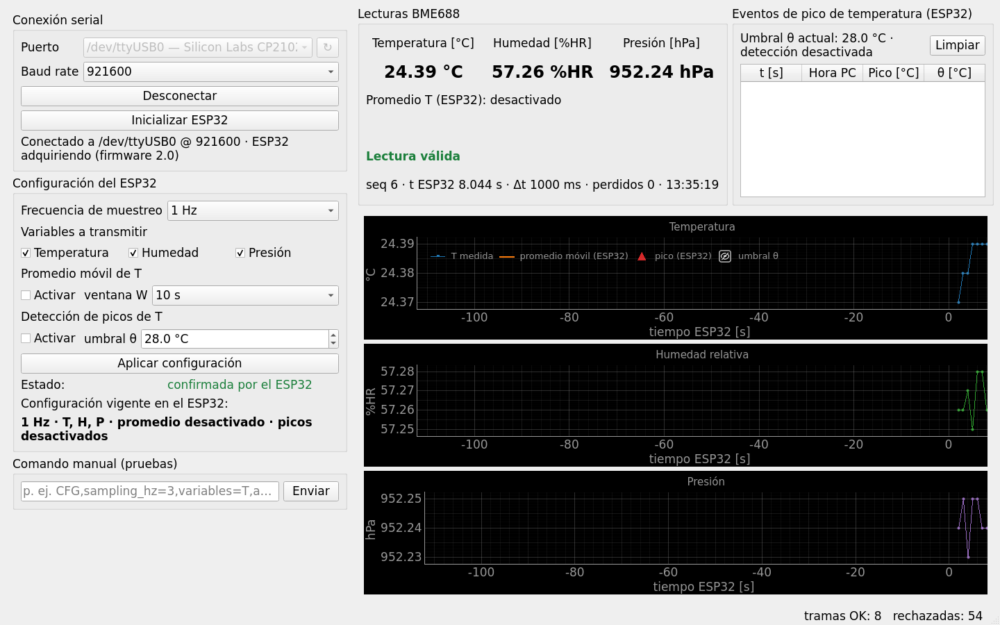
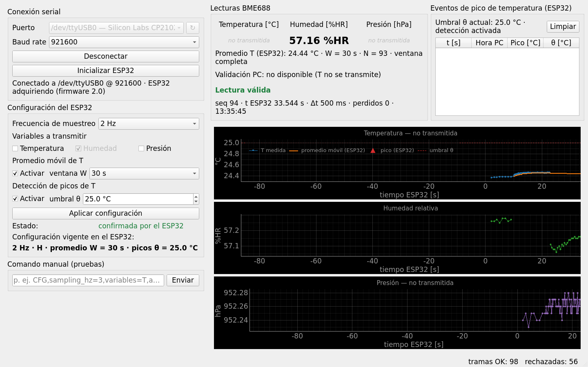
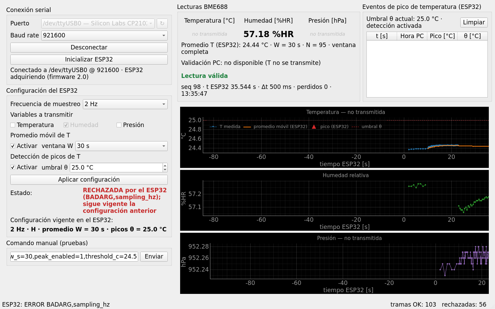
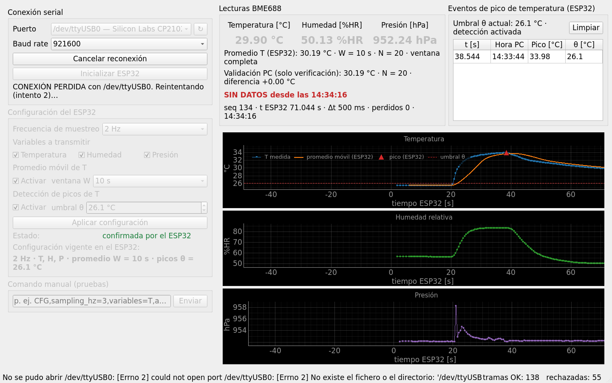
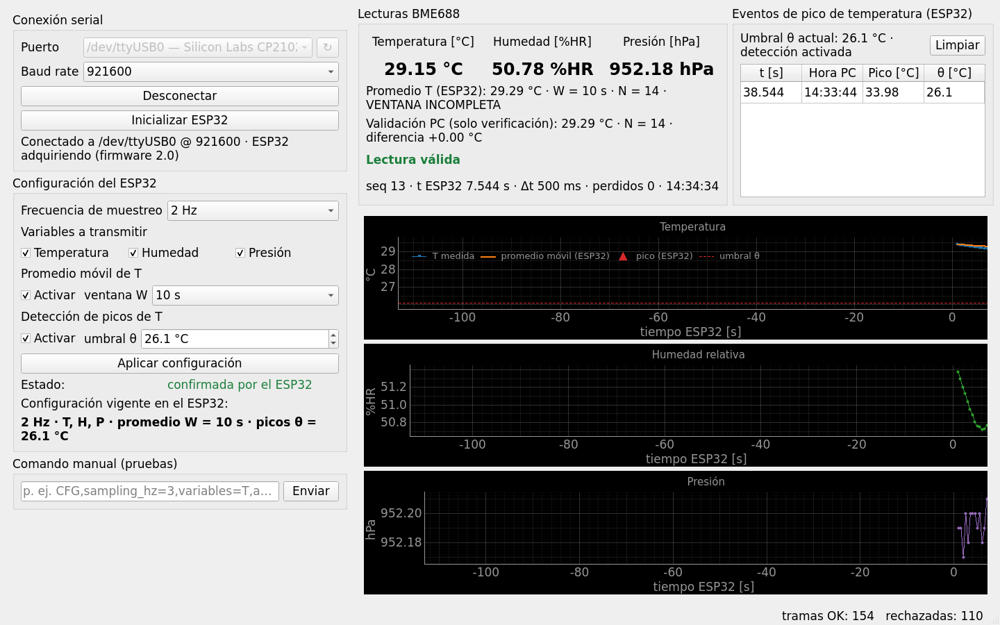
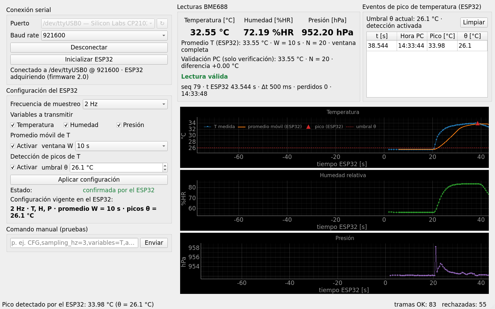

# Tarea 2: Adquisición con BME688 y procesamiento local

**CC5328-1 Sistemas Embebidos y Sensores · Universidad de Chile · Semestre 2026-2**

Un ESP32 lee temperatura, humedad relativa y presión **reales** desde un sensor BME688 por
I²C. Sobre la temperatura calcula una media móvil temporal y detecta picos (máximos locales
sobre un umbral) **en el propio microcontrolador**, y transmite solo las variables
seleccionadas por USB-serial a una aplicación Python/PyQt. La aplicación configura la
adquisición en tiempo real, grafica las señales y muestra los eventos.

**Integrantes:**
Joaquín Acosta,
Matías Saavedra

> Enunciado completo: [`docs/Tarea2_CC5328.pdf`](docs/Tarea2_CC5328.pdf).
>
> **Video de demostración:** [`video_demostracion.mp4`](video_demostracion.mp4) (ver
> [Video de demostración](#video-de-demostración)).

El repositorio parte de la infraestructura de la Tarea 1
([`MFSaavedra/embeddedT1`](https://github.com/MFSaavedra/embeddedT1)), probada sobre la misma
placa: protocolo con checksum, enlace UART con cambio de velocidad en caliente, hilo serial
de la GUI, panel de conexión y sus pruebas. Lo nuevo de la Tarea 2 es el sensor, la
adquisición, el procesamiento local, la configuración en tiempo real y los paneles que la
muestran.



## Estructura del repositorio

```
esp32_firmware/          Firmware ESP-IDF (C)
  CMakeLists.txt         Proyecto idf.py
  sdkconfig.defaults     Configuración base (target esp32, consola a 921600 baud)
  components/bme68x/     BME68x SensorAPI de Bosch v4.4.8, sin modificar (licencia BSD-3)
  main/
    main.c               app_main: inicializa los módulos
    app_config.h         Constantes, pines I²C y valores por defecto del enunciado
    protocol.[ch]        Paquete "$payload*XX" + checksum XOR (espejo de gui_python/protocol.py)
    uart_link.[ch]       Driver UART0, envío de paquetes, recepción por líneas, cambio de baud
    commands.[ch]        Comandos de la GUI (CFG / INIT / BAUD) y respuestas ACK / ERR
    bme688.[ch]          Bus I²C y sensor BME688 sobre la API de Bosch (T, H, P; calefactor apagado)
    sampler.[ch]         Tarea de adquisición: lee, procesa y envía SMP / PEAK
    sampler_cfg.[ch]     La configuración: valores por defecto, validación y texto del comando CFG
    temp_proc.[ch]       Media móvil temporal y detección de picos (C puro, probado en el PC)
gui_python/              Aplicación PyQt5
  main.py                Punto de entrada
  main_window.py         Ventana principal: conecta paneles, gráficos y puerto serie
  serial_worker.py       Hilo de lectura/escritura serial (pyserial + QThread)
  protocol.py            Paquetes y checksum (espejo de protocol.c)
  messages.py            Significado de los campos: arma CFG, decodifica SMP / PEAK / ACK,CFG
  widgets/               Un archivo por panel: conexión, configuración, lecturas, picos,
                         gráficos y comando manual
tests/                   Pruebas automáticas (pytest)
  firmware/              Pruebas en C del firmware, compiladas para el PC
docs/                    Enunciado y capturas de pantalla
requirements.txt         Dependencias Python
Doxyfile                 Documentación del código (Doxygen)
```

## Reutilización de la Tarea 1

La comunicación de la Tarea 1 ya estaba probada en esta misma placa, así que se reutilizó y el
código nuevo se limitó a lo que agrega la Tarea 2. Columna "Reutilizado": porcentaje de las
líneas del archivo de la Tarea 2 que son idénticas a su original de la Tarea 1.

| Archivo de la Tarea 2 | Original de la Tarea 1 | Reutilizado | Qué cambió |
|---|---|---|---|
| `protocol.c`, `uart_link.c`, `uart_link.h`, `sdkconfig.defaults` | los mismos | 100 % | nada |
| `serial_worker.py` (hilo serial, reinicio de la placa, cambio de velocidad) | el mismo | 98 % | un comentario |
| `protocol.h` · `protocol.py` | los mismos | 97 % · 83 % | comentarios y nombres de los mensajes |
| `connection_panel.py` | el mismo | 84 % | estado "reconectando" |
| `commands.c` | el mismo | 78 % | `CFG` nuevo; despachador, `parse_field()` y `BAUD` sin cambios |
| `main_window.py` | el mismo | 45 % | renegociación de velocidad y contadores sin cambios; ruteo de `SMP`/`PEAK`/`CFG` y reconexión nuevos |
| `sensor_plots.py` | `accel_plots.py` | 25 % | buffers circulares y redibujo por temporizador; nuevos: T/H/P, promedio, θ y picos |
| `config_panel.py` | `config_panel.py` | 18 % | `_combo()`; controles de la Tarea 2 |
| `readings_panel.py` | `env_panel.py` | 10 % | estructura del panel; nuevos: promedio, validación, estados |
| `tests/test_serial_worker.py` · `test_protocol.py` · `test_main_window.py` | los mismos | 99 % · 81 % · 44 % | pruebas nuevas de la Tarea 2 |

Sin equivalente en la Tarea 1: el sensor (`bme688.c`, sobre la API de Bosch; sus funciones
de I²C y de espera vienen de la prueba de puesta en marcha del equipo), la adquisición
(`sampler.c`, que conserva de `accel_sim.c` el patrón de configuración validada y atómica
que solo arranca con `INIT`), `sampler_cfg.c`, `temp_proc.c`, `messages.py` y los paneles de
picos y de comando manual. Los simuladores de la Tarea 1 (`accel_sim`, `env_sim`) se
eliminaron, porque el enunciado prohíbe enviar datos inventados.

## Requisitos

| Componente | Versión |
|---|---|
| Tarjeta | ESP32 DevKit (target `esp32`, puente USB-serial CP2102) |
| Sensor | BME688 en módulo con interfaz I²C |
| Framework firmware | ESP-IDF v6.1 (probada, sin advertencias). El código solo usa APIs que también existen en v5.5 |
| Python | 3.8+ |
| Librerías GUI | PyQt5, pyserial, pyqtgraph, numpy (`requirements.txt`) |

## Conexión física

Verificado con el módulo del equipo: es un BME688 auténtico (chip id `0x61`, variante `0x01`)
en la dirección `0x76` (SDO a GND), con resistencias de pull-up propias en SDA y SCL.

| BME688 (módulo) | ESP32 | Notas |
|---|---|---|
| VCC / VIN | 3V3 | |
| GND | GND | |
| SDA | GPIO21 | `BME688_SDA_GPIO` en `app_config.h` |
| SCL | GPIO22 | `BME688_SCL_GPIO` en `app_config.h` |
| SDO / ADDR | GND → `0x76` · 3V3 → `0x77` | el firmware prueba `0x76` (el módulo del equipo) y luego `0x77` |
| CS (si existe) | 3V3 | en alto selecciona I²C |

GPIO21 y GPIO22 son los pines I²C habituales del ESP32 DevKit. Están libres en la placa y no
son pines de *strapping* (0, 2, 5, 12, 15), de la flash (6–11) ni de solo entrada (34–39). El
bus funciona a 100 kHz. El módulo trae sus propias resistencias de pull-up, y el firmware
habilita además las internas del ESP32 como respaldo. Al arrancar, el monitor serial indica
si encontró el sensor y cuánto dura una conversión:

```
I (169) bme688: BME688 found at 0x76 (chip id 0x61, variant 0x01), conversion 42590 us
```

## Compilación y carga del firmware

```bash
# 1. Activar ESP-IDF (según la instalación)
. $IDF_PATH/export.sh                 # o el script del instalador, p. ej. ~/.espressif/tools/activate_idf_v6.1.sh

# 2. Compilar
cd esp32_firmware
idf.py build

# 3. Cargar y abrir el monitor serial (Ctrl+] para salir)
idf.py -p /dev/ttyUSB0 flash monitor
```

Notas:

- La API de Bosch viene incluida en `components/bme68x/`; no hay que descargar nada más.
- En Linux el usuario debe pertenecer al grupo `dialout` para abrir `/dev/ttyUSB0`.
- El monitor de `idf.py` y la GUI **no pueden usar el puerto al mismo tiempo**: hay que cerrar
  el monitor antes de conectar desde la aplicación.
- Los cambios permanentes de configuración van en `sdkconfig.defaults` (`sdkconfig` está
  ignorado por git). Para regenerarlo: `rm sdkconfig && idf.py reconfigure`.
- La consola y el enlace funcionan a **921600 baud** (`LINK_BAUD` en `main/app_config.h` y
  `sdkconfig.defaults`).

## Ejecución de la aplicación

```bash
python3 -m venv .venv && source .venv/bin/activate      # Windows: .venv\Scripts\activate
pip install -r requirements.txt
python gui_python/main.py
```

## Uso

1. **Conectar.** Conectar el ESP32 por USB, elegir el puerto (los adaptadores USB-serial
   aparecen primero, con su descripción) y pulsar **Conectar**. La GUI abre el puerto a
   921600, reinicia la tarjeta (pulso en EN) y espera ~1 s antes de habilitar los controles. El
   selector de baud rate indica la velocidad deseada del enlace; si difiere de 921600, se
   renegocia en cuanto la conexión está lista.
2. **Inicializar.** Pulsar **Inicializar ESP32**. El firmware vuelve a la configuración por
   defecto (1 Hz, T/H/P, promedio y picos desactivados, W = 10 s, θ = 28,0 °C), responde `ACK`
   e inicia la adquisición. El estado de conexión pasa a "ESP32 adquiriendo (firmware 2.0)".
3. **Configurar.** En **Configuración del ESP32** se elige la frecuencia (0,5 / 1 / 2 / 5 Hz),
   las variables a transmitir (la última marcada no se puede desmarcar: una selección vacía es
   imposible), el promedio móvil (activar + ventana W de 5, 10, 30 o 60 s) y la detección de
   picos (activar + umbral θ con resolución 0,1 °C). **Aplicar configuración** envía todo en
   un solo comando `CFG`. El estado queda "esperando la confirmación del ESP32" hasta que llega
   el `ACK`, y **Configuración vigente en el ESP32** muestra la que el ESP32 confirmó (no la
   de los controles). Si el ESP32 rechaza el comando, el estado dice **RECHAZADA** y la
   configuración anterior sigue vigente.
4. **Lecturas.** El panel **Lecturas BME688** muestra T [°C], H [%HR] y P [hPa]; una variable
   no seleccionada dice "no transmitida". Debajo: el **promedio de T calculado por el ESP32**
   (con su N y si la ventana está completa) y la **validación PC**, el mismo promedio
   recalculado en el PC con las temperaturas recibidas, rotulado como "solo verificación". El
   estado indica "Lectura válida", "LECTURA INVÁLIDA" (el ESP32 no pudo leer el sensor) o
   "SIN DATOS" (no llegan paquetes desde hace 2,5 periodos). La última línea tiene el número
   de secuencia, el instante del ESP32, el Δt entre paquetes y los paquetes perdidos.
5. **Gráficos.** Historia de T, H y P en el tiempo del ESP32 (últimos 120 s). El gráfico de
   temperatura muestra además el promedio móvil del ESP32 (naranjo), el umbral θ (línea roja
   segmentada) y los picos detectados (triángulos rojos), incluso si T no se transmite. Un
   gráfico cuya variable no se transmite lo indica en su título.
6. **Eventos de pico.** Tabla con cada evento `PEAK`: instante del pico en el ESP32, hora del
   PC, valor del pico y umbral aplicado; arriba, el umbral vigente.
7. **Comando manual (pruebas).** Envía cualquier comando tal como se escribe (con checksum
   correcto), por ejemplo una configuración inválida, para ver cómo la rechaza el ESP32.
8. **Desconexión.** Si el puerto se cae sin que el usuario lo pida (cable desconectado), la
   GUI muestra **CONEXIÓN PERDIDA** y reintenta cada 1 s (**Cancelar reconexión** detiene los
   reintentos). Al volver, la placa arrancó de nuevo: la GUI envía `INIT` y luego la
   configuración que estaba confirmada, y la adquisición sigue como antes del corte.

La barra de estado muestra las respuestas del ESP32 y un contador de paquetes válidos y
rechazados (los mensajes de arranque y de log de la placa cuentan como rechazados).

## Protocolo de comunicación

Protocolo de texto, un paquete por línea, heredado de la Tarea 1 e implementado de forma
idéntica en `protocol.c` y `protocol.py`:

```
$<payload>*<XX>\n
```

- `payload`: campos separados por coma; el primero es el tipo de mensaje.
- `XX`: checksum, el XOR de todos los bytes del payload, en dos dígitos hexadecimales.
  Ejemplo: `INIT` → `'I'^'N'^'I'^'T'` = `0x1A` → `$INIT*1A`.
- Cualquier línea que no cumpla el formato o cuyo checksum no coincida se descarta y se
  cuenta (mensajes de arranque, `ESP_LOG`, bytes corruptos).

Los mensajes de la Tarea 2 usan campos `clave=valor`: el conjunto de variables cambia de un
paquete a otro según la selección, y así cada valor viaja etiquetado (el enunciado pide que el
promedio viaje "etiquetado como `temp_avg_c`"). El tipo distingue las cinco clases de mensaje
que pide el enunciado: **comandos** (`CFG`, `INIT`, `BAUD`), **confirmaciones** (`ACK`),
**errores** (`ERR`), **datos** (`SMP`) y **eventos** (`PEAK`).

### PC → ESP32 (comandos)

| Comando | Paquete | Respuesta |
|---|---|---|
| Configurar | `$CFG,sampling_hz=<0.5\|1\|2\|5>,variables=<T\|H\|P\|TH\|TP\|HP\|THP>,avg_enabled=<0\|1>,window_s=<5\|10\|30\|60>,peak_enabled=<0\|1>,threshold_c=<-40.0..85.0>*XX` | `$ACK,CFG,<configuración vigente, mismas claves>*XX` o `$ERR,BADARG,<clave>*XX` |
| Inicializar | `$INIT*XX`: configuración por defecto e (re)inicio de la adquisición | `$ACK,INIT,<versión>*XX` |
| Cambiar velocidad | `$BAUD,<baud>*XX`: `115200`/`230400`/`460800`/`921600` | `$ACK,BAUD,<baud>*XX` (a la velocidad **anterior**) o `$ERR,BADARG*XX` |

`CFG` lleva **siempre los seis campos, en ese orden**: es la configuración completa, y se
aplica de forma atómica. Si un campo es inválido se responde `ERR,BADARG,<clave>` nombrando el
primero inválido (`fields` si no hay exactamente seis) y **no cambia nada**. Las variables
son las letras T, H y P en cualquier orden, sin repetir; el umbral lleva exactamente un
decimal (resolución 0,1 °C). El `ACK,CFG` repite la configuración que quedó vigente, y es lo
que la GUI muestra como confirmado. Errores posibles: `BADFRAME` (formato o checksum),
`EMPTY`, `UNKNOWN` (tipo desconocido) y `BADARG` (valor fuera de las opciones permitidas).

### ESP32 → PC (datos y eventos)

| Mensaje | Paquete | Notas |
|---|---|---|
| Muestra | `$SMP,seq=<n>,t_ms=<ms>[,temperature_c=<°C>][,humidity_pct=<%HR>][,pressure_hpa=<hPa>][,temp_avg_c=<°C>,avg_n=<N>,avg_window_complete=<0\|1>]*XX` | Solo las variables seleccionadas, con dos decimales. El promedio viaja aunque T no esté seleccionada |
| Lectura fallida | `$SMP,seq=<n>,t_ms=<ms>,error=<no_sensor\|read_failed>*XX` | Sin valores: nunca se inventan |
| Pico | `$PEAK,t_ms=<ms>,peak_c=<°C>,threshold_c=<°C>*XX` | Un evento por pico; `t_ms` es el de la muestra del pico |

- `seq` aumenta en 1 por cada `SMP` desde `INIT`, incluidas las lecturas fallidas: un salto en
  la secuencia es un paquete perdido en el enlace.
- `t_ms` es el instante (ms desde el arranque del ESP32) en que empezó la medición.
- `avg_n` es N_W(t), el número de muestras en el promedio, y `avg_window_complete` indica si la
  adquisición ya cubre una ventana W completa.
- `no_sensor`: el sensor no respondió a la inicialización; `read_failed`: una lectura falló o
  dio valores fuera del rango del sensor.

Ejemplo equivalente al del enunciado (T y P seleccionadas, promedio y picos activos; los
checksums son reales):

```
PC → ESP32   $CFG,sampling_hz=2,variables=TP,avg_enabled=1,window_s=10,peak_enabled=1,threshold_c=28.0*5E
ESP32 → PC   $ACK,CFG,sampling_hz=2,variables=TP,avg_enabled=1,window_s=10,peak_enabled=1,threshold_c=28.0*3B
             $SMP,seq=145,t_ms=73210,temperature_c=26.40,pressure_hpa=1012.70,temp_avg_c=26.10,avg_n=20,avg_window_complete=1*4F
             $PEAK,t_ms=75410,peak_c=28.70,threshold_c=28.0*53
PC → ESP32   $CFG,sampling_hz=3,variables=TP,avg_enabled=1,window_s=10,peak_enabled=1,threshold_c=28.0*5F
ESP32 → PC   $ERR,BADARG,sampling_hz*18
             $SMP,seq=146,t_ms=73710,error=read_failed*3A
```

## Decisiones de diseño

### Heredadas de la Tarea 1 (siguen vigentes)

- **Velocidad del enlace.** El enlace arranca a **921600 baud** en ambos extremos
  (`LINK_BAUD` en el firmware, `DEFAULT_BAUD` en la GUI). En la Tarea 1 era necesario
  (3 ejes × 1000 Hz). En la Tarea 2 el peor caso es ~130 B por muestra a 5 Hz ≈ 6,5 kbaud,
  que cualquier velocidad soporta; se mantiene 921600 porque es la configuración validada con
  esta placa.
- **Cambio de velocidad en caliente.** El selector de baud de la GUI indica la velocidad a la
  que debe funcionar el enlace. La GUI envía `$BAUD,<baud>`; el firmware detiene la
  adquisición, responde *a la velocidad antigua*, espera a que se vacíe el buffer de
  transmisión y recién entonces conmuta. La GUI conmuta al recibir esa respuesta y envía
  `$INIT`, que confirma la velocidad y reanuda la adquisición; como `INIT` restaura los
  valores por defecto, la GUI reenvía a continuación la configuración que estaba vigente. La
  velocidad nueva es provisional: si el firmware no recibe un paquete válido en 5 s
  (`LINK_BAUD_REVERT_MS`) vuelve a 921600, y la GUI hace lo mismo a los 8 s. El puerto se abre
  **siempre** a 921600, porque la placa se reinicia al conectar y arranca a `LINK_BAUD`.
- **Reinicio explícito al conectar.** Abrir el puerto conmuta DTR/RTS de forma no
  controlada, y en Linux con el puente CP2102 eso dejaba al ESP32 colgado en la mayoría de
  las conexiones (1–4 útiles de cada 10). `SerialWorker` aplica la misma secuencia que
  `esptool` para un *hard reset*: DTR inactivo, RTS activo 100 ms, RTS inactivo. Solo
  habilita los controles tras `BOOT_WAIT_S` = 1 s, con lo que se logran 10 de 10 conexiones
  útiles.
- **Consola compartida.** UART0 transporta datos y logs. Los logs no empiezan con `$` y se
  descartan en la GUI y en el parser, y `uart_vfs_dev_use_driver()` evita que un log quede
  intercalado dentro de un paquete.
- **"Inicializar ESP32" como punto de entrada.** La adquisición no arranca al encender: solo
  `$INIT` la inicia, tras restaurar la configuración por defecto y responder `ACK` *antes*
  del primer dato, de modo que la GUI se reinicia con el `ACK`. `$BAUD` la detiene.
- **Lectura serial sin bloquear la GUI.** Todo el acceso al puerto ocurre en un `QThread`
  (`SerialWorker`), que entrega cada paquete a la ventana mediante señales de Qt. Los
  gráficos se redibujan con un temporizador (10 por segundo), nunca por muestra.

### Propias de la Tarea 2

- **Sensor (FW1).** Se usa la BME68x SensorAPI oficial de Bosch (permitida por el enunciado),
  sin modificar, en `components/bme68x/`; `bme688.c` solo le entrega las funciones de lectura
  y escritura I²C y de espera. Modo *forzado*: cada lectura dispara una conversión de T, P y
  H. Sobremuestreo T×2, P×16, H×1 (el de la autoprueba de Bosch) y **filtro IIR apagado**,
  porque un filtro retrasa y aplana justamente los picos que hay que detectar.
- **Tiempo de conversión (enunciado 2.1.4).** La API predice 42,6 ms por conversión y se
  midieron 40,3 ms en esta placa. El firmware espera el tiempo predicho **redondeado hacia
  arriba** a ticks de FreeRTOS (10 ms) más un tick, porque redondear hacia abajo leería antes
  de terminar la conversión. Además la API rechaza el resultado si el sensor no lo marca como
  dato nuevo. La lectura completa toma ~50–60 ms, menos que el periodo más corto (200 ms).
- **Frecuencia común configurable.** Las cuatro frecuencias son periodos de 2000, 1000, 500
  y 200 ms, múltiplos exactos del tick. La tarea de adquisición se despierta con
  `xTaskDelayUntil()` y relee el periodo en cada ciclo, así un cambio rige desde la lectura
  siguiente sin reiniciar nada. `t_ms` se toma al comenzar cada medición, por lo que el Δt
  entre paquetes es exactamente el periodo (medido abajo).
- **Selección de variables ≠ adquisición.** El sensor siempre mide T, H y P; la selección
  solo decide qué viaja en cada `SMP`. La temperatura alimenta **siempre** el promedio y el
  detector de picos, aunque no se transmita (enunciado 2.2, "Importante").
- **Configuración atómica (enunciado 5).** Toda la configuración es una estructura
  (`sampler_cfg_t`). `CFG` trae los seis campos y `sampler_cfg_parse()` valida todos antes de
  aplicar nada, de modo que un comando inválido no deja configuraciones a medias. La
  configuración vive tras un mutex que la tarea de adquisición mantiene durante un ciclo
  completo (leer, procesar, enviar): un cambio se aplica entre dos lecturas, nunca a mitad de
  una, y todo `SMP` posterior al `ACK,CFG` ya usa la configuración nueva. La GUI solo muestra
  como vigente lo que el ESP32 confirmó.
- **Media móvil temporal (enunciado 3.1).** T̄_W(t) es la media de las temperaturas con
  t − W < t_i ≤ t. El firmware retiene las últimas 320 temperaturas, que cubren la ventana más
  larga (60 s) a la frecuencia más alta (5 Hz) con margen, **sin importar la W vigente**. Por
  eso un cambio de W rige de inmediato con las muestras ya retenidas. La ventana se informa
  completa (`avg_window_complete=1`) cuando la adquisición lleva al menos W segundos desde
  `INIT`; durante el arranque, y justo después de agrandar W, se calcula con las muestras
  disponibles y se informa incompleta. Las muestras se borran solo con `INIT`; activar o
  desactivar el promedio solo decide si se envía.
- **Detección de picos (enunciado 3.2).** El criterio mínimo del enunciado
  (T[k−1] > T[k−2], T[k−1] ≥ T[k], T[k−1] ≥ θ) se dispara con el **ruido** del sensor: con la
  temperatura estable sobre θ, cada pequeña oscilación (ruido medido: 0,02 °C rms) forma un
  "máximo local"; en la placa, un detector casi sin histéresis (0,02 °C) dio 14 eventos en
  40 s a temperatura constante. Por eso el detector usa **histéresis h = 0,2 °C**
  (`PEAK_HYSTERESIS_C`), diez veces el ruido medido:
  - mientras la temperatura sube, el máximo alcanzado es el candidato a pico;
  - el candidato se **confirma** cuando la temperatura baja h por debajo de él, y se emite un
    `PEAK` si es ≥ θ, con el valor y el instante **de la muestra del pico** (no de la que lo
    confirmó) y el umbral aplicado;
  - después, el detector busca el mínimo, y solo cuando la temperatura vuelve a subir h sobre
    ese mínimo comienza a buscar el siguiente pico.

  Consecuencias: superar θ no basta (una rampa que nunca baja no da eventos); las
  oscilaciones menores que h, como el ruido, no producen picos; cada pico se informa **una
  sola vez**; una meseta se informa en su primera
  muestra; y todo pico informado cumple la regla mínima del enunciado (es mayor que la muestra
  anterior, mayor o igual que la siguiente y ≥ θ). El costo es que el evento llega cuando la
  temperatura ya bajó 0,2 °C desde el máximo, unos segundos después del pico. Todo esto se
  comprueba con series conocidas en `tests/firmware/test_temp_proc.c` (ver
  [Pruebas automáticas](#pruebas-automáticas)).
- **Sin valores inventados (enunciado 2.1.2).** Si el sensor no responde al arrancar, o una
  lectura falla o da valores fuera del rango de operación del sensor (T −40..85 °C,
  H 0..100 %HR, P 300..1100 hPa), el `SMP` lleva `error=<código>` y ningún valor; tampoco se
  actualizan el promedio ni el detector. La tarea de adquisición, única usuaria del sensor,
  lo reinicializa en el ciclo siguiente, de modo que la adquisición se recupera sola cuando
  el sensor vuelve a responder. La GUI muestra "LECTURA INVÁLIDA" y no grafica nada.
- **Robustez de la GUI.** Los comandos rechazados se muestran (barra de estado y panel de
  configuración); si no llegan paquetes en 2,5 periodos la GUI lo indica ("SIN DATOS"); los
  saltos de `seq` se cuentan como paquetes perdidos; un paquete con checksum válido pero
  campos mal formados se descarta sin tocar la pantalla y se cuenta como rechazado. Una
  desconexión no pedida se reintenta automáticamente y restaura la sesión (ver
  [Uso](#uso), paso 8).
- **El cómputo es del ESP32 (enunciado 4).** El promedio y los picos que muestra la GUI son
  los que envía el ESP32. El PC solo recalcula el promedio para validarlo, con la misma
  definición y las temperaturas recibidas, y lo rotula "Validación PC (solo verificación)".
- **Calentador de gas apagado.** El enunciado no pide la medición de gas, y el calentador
  falsea la temperatura: medido con este sensor, cuatro pulsos de 100 ms a 300 °C subieron la
  lectura de temperatura en unos 0,7 °C, que tardaron ~2 s en disiparse. Eso alteraría el
  promedio y podría generar picos falsos.

## Pruebas automáticas

`pytest`, ejecutado desde la raíz del repositorio, corre todo `tests/` (67 pruebas, todas pasan):

- **Firmware compilado para el PC** (`tests/test_firmware_host.py`, requiere `gcc`/`cc`):
  - `test_temp_proc.c`: el promedio comparado en cada paso con un **cálculo de referencia**
    hecho directamente desde la definición (W = 5, 10 y 30 s), los bordes de la ventana, el
    arranque, el cambio de W con las muestras retenidas, el desborde del buffer a 5 Hz × 60 s
    y el desborde del reloj de 32 bits. Los picos con **series conocidas**: un pico limpio
    (1 evento, con su instante), una meseta (1), una rampa sobre θ (0: superar θ no es un
    pico), un máximo bajo θ (0), una meseta con ruido de ±0,05 °C (la regla mínima sola se
    dispara más de 5 veces; el detector, una), dos picos (2), sin subida previa (0) y el
    umbral vigente al confirmar.
  - `test_sampler_cfg.c`: el comando `CFG`: ida y vuelta de configuraciones válidas, las siete
    combinaciones de variables y el rechazo de cada forma inválida (campos de más o de menos,
    claves cambiadas de orden o mal escritas, cada valor fuera de su conjunto), verificando
    que un rechazo no escribe nada.
  - `test_protocol_c.c`: `protocol.c` con los mismos bytes que la prueba en Python.
- **GUI**: los mensajes (`test_messages.py`, con las mismas cadenas `CFG` que acepta el
  firmware), el hilo serial contra un puerto simulado, la renegociación de velocidad, el
  ruteo de `SMP` / `PEAK` / `ACK` / `ERR`, el ciclo de vida de una configuración (pendiente,
  confirmada, rechazada), el aviso de "sin datos", la reconexión automática con restauración
  de la sesión, y los paneles y gráficos.

## Pruebas obligatorias (sección 6 del enunciado)

Hechas con el firmware y la GUI de este repositorio sobre el montaje real (ESP32 DevKit +
BME688 en `0x76`, GPIO21/22), en interior, el 2 de noviembre de 2026. Las capturas son de la
GUI conectada a la placa.

| # | Prueba | Procedimiento | Resultado |
|---|---|---|---|
| 1 | Lecturas reales | Conectar, **Inicializar ESP32** (1 Hz, T/H/P). Cableado y unidades en [Conexión física](#conexión-física) y en el panel de lecturas | T ≈ 24,4 °C, H ≈ 57 %HR, P ≈ 952,2 hPa (interior, Santiago, ~520 m), con variaciones de 0,01–0,02 entre muestras; Δt = 1000 ms (captura 1) |
| 2 | Siete combinaciones | Aplicar cada combinación de variables y observar los `SMP` | Las siete probadas: cada `SMP` trae exactamente las variables elegidas ([detalle](#detalle-de-las-pruebas)). La selección vacía es imposible en la GUI y el firmware la rechaza (`ERR,BADARG,variables`) |
| 3 | Cambio dinámico de frecuencia | Cambiar 1 → 5 → 0,5 → 2 Hz sin reiniciar y medir el Δt de `t_ms` | 225 muestras: a 1 Hz los 10 intervalos midieron 1000 ms; a 5 Hz los 180, 200 ms; a 0,5 Hz, 2000 ms; a 2 Hz, 500 ms. `seq` consecutivo, 0 perdidos. Cada cambio rige desde la lectura siguiente |
| 4 | Promedio | Activar el promedio con W = 5 s y luego W = 30 s, y comparar `temp_avg_c` con la media recalculada de las temperaturas recibidas | 198 promedios comparados: diferencia máxima 0,0054 °C, lo esperable porque los valores viajan con dos decimales (en otra corrida, 483 promedios con W = 60 s: máx. 0,0075 °C). Al pasar a W = 30 s, N subió de 25 a 72 con las muestras ya retenidas y la ventana se informó incompleta hasta cubrir 30 s. En la GUI: "diferencia +0.00" (captura 2) |
| 5 | Picos | Fijar θ cerca de la temperatura ambiente, calentar el sensor con un dedo unos segundos y soltarlo | Con θ = 26,1 °C (ambiente 25,6 °C), un dedo sobre el sensor durante ~18 s subió T hasta 33,98 °C; al soltarlo llegó **un único** evento, `PEAK,t_ms=38544,peak_c=33.98,threshold_c=26.1`, con el instante de la muestra máxima, 1 s después del máximo (cuando T bajó a 33,74 °C). T siguió sobre θ más de 30 s mientras se enfriaba, sin repetir el evento (captura 7). Además: en 10 minutos sin tocar nada, la temperatura ambiente subió lentamente por encima de θ (25,20 °C con θ = 25,1 °C) sin ningún evento, porque superar θ no es un pico; y una compilación de prueba con h = 0,02 °C dio 14 eventos en 40 s a temperatura estable, que es por qué h = 0,2 °C |
| 6 | Procesamiento con T oculta | Seleccionar solo H (o H y P) con promedio y picos activos | Cada `SMP` sigue trayendo `temp_avg_c` sin `temperature_c` (p. ej. `SMP,seq=213,t_ms=69244,humidity_pct=56.96,temp_avg_c=24.45,avg_n=16,avg_window_complete=1`), y el gráfico de T sigue mostrando el promedio (captura 3) |
| 7 | Errores | Enviar una configuración inválida con el comando manual; desconectar y reconectar el cable USB | Cada CFG inválida fue rechazada nombrando el campo y sin cambiar nada (captura 4, [detalle](#detalle-de-las-pruebas)). Al desenchufar el cable USB, la GUI mostró CONEXIÓN PERDIDA y reintentó cada ~1 s; al enchufarlo, reconectó (11,5 s después del corte), la placa arrancó de nuevo y la GUI envió `INIT` y la configuración anterior sin intervención (capturas 5 y 6). Fallos del sensor: ver detalle |

### Detalle de las pruebas

**Siete combinaciones** (5 Hz; primer `SMP` tras cada `ACK,CFG`, sin el checksum):

| Variables | `SMP` recibido |
|---|---|
| T | `SMP,seq=1,t_ms=3044,temperature_c=24.34` |
| H | `SMP,seq=4,t_ms=3644,humidity_pct=57.11` |
| P | `SMP,seq=8,t_ms=4444,pressure_hpa=952.18` |
| T, H | `SMP,seq=12,t_ms=5244,temperature_c=24.38,humidity_pct=57.10` |
| T, P | `SMP,seq=16,t_ms=6044,temperature_c=24.38,pressure_hpa=952.17` |
| H, P | `SMP,seq=21,t_ms=7044,humidity_pct=57.08,pressure_hpa=952.15` |
| T, H, P | `SMP,seq=25,t_ms=7844,temperature_c=24.39,humidity_pct=57.06,pressure_hpa=952.17` |

**Comandos inválidos** enviados a la placa (cada uno rechazado sin cambiar la configuración;
la adquisición siguió sin interrupción):

| Enviado | Respuesta |
|---|---|
| `CFG` con `sampling_hz=3` | `ERR,BADARG,sampling_hz` |
| `CFG` con `variables=` (vacío) o `variables=TT` | `ERR,BADARG,variables` |
| `CFG` con `window_s=7` | `ERR,BADARG,window_s` |
| `CFG` con `threshold_c=20.05` (dos decimales) | `ERR,BADARG,threshold_c` |
| `CFG,sampling_hz=5,variables=TP` (faltan campos) | `ERR,BADARG,fields` |
| `FOO` | `ERR,UNKNOWN` |
| `$INIT*00` (checksum incorrecto) | `ERR,BADFRAME` |

**Fallos del sensor.** No se pueden provocar sin tocar el cableado, así que se verificaron con
dos compilaciones de prueba (no incluidas en el repositorio): con SDA asignado a un pin sin
conexión, cada `SMP` llegó como `error=no_sensor`, sin valores, mientras la placa seguía
respondiendo comandos; forzando que fallara una de cada diez lecturas, cada falla llegó
como `error=read_failed` con su `seq`, el sensor se reinicializó en el ciclo siguiente y las
lecturas continuaron sin desfasar los tiempos. En el video basta con desconectar el cable SDA
del sensor y volver a conectarlo.

**Cambio de velocidad.** Con la adquisición a 5 Hz (T y H, promedio W = 10 s), elegir
115200 en el selector: `ACK,BAUD,115200` → la GUI conmuta y envía `INIT` → `ACK,INIT,2.0` →
la GUI reenvía la configuración → `ACK,CFG,...`, y los datos siguen llegando a 115200 baud.

### Capturas

| | |
|---|---|
|  |  |
| 1 Hz, T/H/P (prueba 1) | 5 Hz, T y P, promedio W = 5 s validado en el PC (pruebas 2, 3 y 4) |
|  |  |
| Solo H transmitida, promedio W = 30 s del ESP32 (prueba 6) | `sampling_hz=3` rechazado; sigue la configuración anterior (prueba 7) |
|  |  |
| Cable USB desenchufado: "CONEXIÓN PERDIDA", reintentando (prueba 7) | Cable enchufado de nuevo: la GUI reconectó y restauró la configuración; el historial de picos se conserva (prueba 7) |
|  | |
| Un dedo sobre el sensor: un único evento `PEAK` de 33,98 °C con θ = 26,1 °C, marcado en el gráfico (prueba 5) | |

## Video de demostración

**Archivo: [`video_demostracion.mp4`](video_demostracion.mp4)**, en la raíz del repositorio
(9:13 min, 97,2 MB). Audio: música de fondo en bucle («Title», de Wii Sports); la
explicación va en los rótulos.

Grabación de pantalla en tiempo real de la GUI conectada al montaje real (ESP32 DevKit +
BME688), con tres tomas de celular intercaladas que muestran el montaje físico: la mano
tocando el sensor BME688 (pruebas 5 y 6) y desconectando y volviendo a conectar el cable USB del
ESP32 (prueba 7), con la pantalla reaccionando. Un rótulo en la
parte superior explica cada paso; los avisos naranjos son las acciones físicas que un
integrante hizo en ese momento sobre el montaje: tocar el sensor con un dedo (pruebas 5 y 6)
y desconectar y volver a conectar el cable USB (prueba 7). El cursor señala, y un recuadro rojo
destaca, cada control que se usa.

| Tiempo | Contenido |
|---|---|
| 0:01 | Tarea 2 CC5328 · BME688 + ESP32 + PyQt — demostración |
| 0:13 | Conexión |
| 0:32 | Prueba 1 · Lecturas reales |
| 1:07 | Prueba 2 · Siete combinaciones de variables |
| 1:42 | Prueba 2 · Selección vacía imposible |
| 2:36 | Prueba 3 · Cambio dinámico de frecuencia |
| 3:07 | Velocidad del enlace serial |
| 3:26 | Prueba 4 · Promedio móvil calculado en el ESP32 |
| 4:01 | Prueba 4 · Cambio de W de 5 s a 30 s |
| 4:12 | Prueba 5 · Detección de picos en el ESP32 |
| 4:28 | Toma de celular: se toca el sensor BME688 con un dedo (montaje real) y la GUI muestra la subida |
| 5:01 | ↳ evento `PEAK,t_ms=261644,peak_c=32.93,threshold_c=29.5` |
| 5:01 | Prueba 5 · Un evento por pico |
| 5:31 | Prueba 6 · Procesamiento con T oculta |
| 5:44 | Toma de celular: segunda subida de temperatura y nuevo evento en la pantalla |
| 6:31 | ↳ evento `PEAK,t_ms=322644,peak_c=34.10,threshold_c=31.5` |
| 6:52 | Prueba 7 · Configuración inválida |
| 7:14 | Prueba 7 · Más comandos inválidos |
| 7:46 | Toma de celular: se desconecta y se vuelve a conectar el cable USB del ESP32; la GUI pierde la conexión y se reconecta |
| 8:24 | Prueba 7 · Desconexión |
| 8:37 | Prueba 7 · Reconexión |
| 8:57 | Resumen |

## Documentación del código

Todo el código C y Python lleva comentarios Doxygen (`@file`, `@brief`, `@param`,
`@return`). Para generar la documentación HTML en `docs/doxygen/html/`:

```bash
doxygen        # desde la raíz del repositorio
```

## Solución de problemas

| Síntoma | Causa / solución |
|---|---|
| `Permission denied: /dev/ttyUSB0` | `sudo usermod -aG dialout $USER` y volver a iniciar sesión |
| `Device or resource busy` | Otro programa (p. ej. `idf.py monitor`) tiene el puerto abierto |
| El contador de paquetes rechazados sube al conectar | Normal: es la salida del bootloader tras el reinicio que hace la GUI al conectar |
| "Conectado", pero **Inicializar ESP32** no responde y los contadores no se mueven | Puerto equivocado: un puerto heredado como `/dev/ttyS0` o `COM1` se abre sin error y no responde. Elegir la entrada con la descripción del adaptador USB (CP2102) |
| "Conectado" a `/dev/ttyUSB0`, rechazadas subió, pero **Inicializar ESP32** no responde | El chip quedó colgado por una conmutación de DTR/RTS fuera de la GUI (p. ej. al cerrar `idf.py monitor`). **Desconectar** y **Conectar** lo reinicia; si persiste, pulsar el botón **EN** de la placa |
| "LECTURA INVÁLIDA (no_sensor)" | El ESP32 no encuentra el sensor: revisar alimentación, SDA/SCL (GPIO21/22) y el pin SDO. Se recupera solo al corregirlo, sin reiniciar |
| "LECTURA INVÁLIDA (read_failed)" | Una lectura falló (cable flojo, interferencia); el firmware reinicializa el sensor en el ciclo siguiente |
| "El ESP32 no respondió al cambio de velocidad" | El puente USB-serial no sostiene esa velocidad. Ambos extremos ya volvieron a 921600; pulsar **Inicializar ESP32** |
| Tras cambiar la velocidad, `idf.py monitor` muestra basura | El monitor sigue a `CONFIG_ESP_CONSOLE_UART_BAUDRATE`; abrirlo con `idf.py monitor -b <baud>` |
| Monitor: `no sensor at 0x76 or 0x77 (ESP_ERR_NOT_FOUND)` | El sensor no responde: revisar alimentación, SDA/SCL (GPIO21/22) y el pin SDO |
| Monitor: `… (ESP_ERR_TIMEOUT)` al buscar el sensor | Bus I²C trabado, normalmente por falta de pull-ups o SDA/SCL invertidos |
